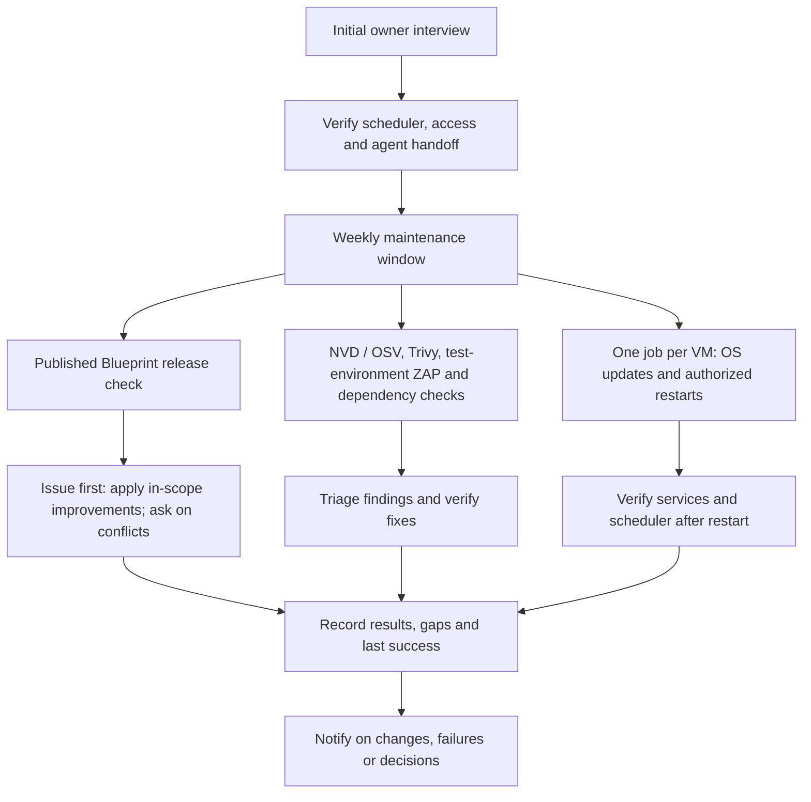

# Project Blueprint

Project Blueprint gives each project a consistent start. After setup, the project’s own repository is the source of truth for how it is built, designed, and maintained. Each project checks weekly for published Blueprint releases, applies relevant improvements within its approved scope, and asks the owner when an update requires a new decision.

Initial setup always includes an owner interview, using the owner's private standing preferences and simpler defaults for small projects, optional Monid and recorded maintenance/reboot choices. Establish the [approved brand foundation](template/design/README.md#brand-foundation-and-settings) before styled UI; each application provides a protected Brand Guidelines settings page, reusing existing identity and tools. Verify the [weekly release check](template/standards/updates.md#periodic-blueprint-maintenance) during setup.

![Before setup, collect ideas in materials/ and wireframes in design/. When the owner says “start planning,” review them together, draft the specification, and confirm setup choices. Application workflow with ten stops: DEVELOPMENT planning, build and security; RELEASE offering, beta and validation; LAUNCH open, feedback and stabilize; PRODUCTION ongoing. Board statuses: dark gray BACKLOG, blue TO DO, yellow IN PROGRESS, lavender REVIEW with testing and deployment, green COMPLETED. Owned issue worktrees follow issue branch to develop to authorized main. Paused work stays IN PROGRESS with pink decision, red setup or silver external reason. Refresh the live queue after completion or pause and before stopping. Explicit authorization precedes private beta and public launch. Owner/developer admin footer shows environment and numbered phase; customer views show neither. GitHub Free requires no paid features](assets/project-workflow-landscape.jpg)

Application workflow overview. [Open the full-size landscape JPEG](assets/project-workflow-landscape.jpg) (11 × 8.5 inches).

## How you operate

| Situation | Your action |
| --- | --- |
| Explore an idea before setup | Collect notes and references in `materials/` and UI wireframes in `design/`. Say “start planning” when you want to [review them together and draft the project specification](template/standards/project.md#setup-interview). |
| Start or adopt a project | Give the agent the setup prompt below and repository access. |
| Request implementation | Tell the agent or move an issue to `TO DO`. It refreshes the live queue, including tasks added during work. |
| Save an idea or recommendation for an active project | Use `BACKLOG` plus one: `idea` (early thought), `suggestion` (recommended improvement), or `proposal` (developed recommendation needing a decision). Approval moves it to `TO DO` and removes the descriptor. |
| `paused: decision` | Answer the recommended A or another option, or give your own answer. |
| `paused: setup` | Complete the linked user-only steps and report the result. |
| `paused: external` | Read the provider/dependency status; usually no action is needed. |
| Clear several pending answers | Request an issue interview with the prompt below. |
| Prepare an offer | Request pricing research with the prompt below; choose a recommendation or give your own terms. |
| Change phase | Say “move to security” or name the next phase; the agent records your decision under [phases.md](template/standards/phases.md). |
| Release | Instruct the agent which release to perform. Passing tests alone does not authorize production. |
| Update these standards | Request a blueprint change; existing projects follow the update guidance in their `AGENTS.md`. |
| Capture recurring workflow lessons | Select optional [Task Observer](template/standards/optional-tools.md#task-observer) during setup; request an observation review when useful. Proposed fixes use the existing issue queue and approval rules. |

The board and matching issue labels follow `BACKLOG → TO DO → IN PROGRESS → REVIEW → COMPLETED`. `REVIEW` shows finished implementation undergoing tests, automated checks, or final delivery verification; it does not require your review of every issue. Fixes return to `IN PROGRESS`.

Paused issues stay `IN PROGRESS` with one pause reason. Comment when a blocker is resolved; the agent verifies it before resuming. During interviews, it immediately records each answer and leaves resolved issues labeled only `IN PROGRESS`, visibly ready to resume. When work resumes, testing/delivery returns to `REVIEW`. Unresolved blockers keep their pause reason.

Before closing, the agent resolves every comment, posts results, and checks for missed input under the [completion checks](template/standards/git-workflow.md#isolation-branches-and-delivery).

Routine work uses [verified direct integration](template/standards/git-workflow.md#isolation-branches-and-delivery), respecting existing protections without adding mandatory pull requests or extra reviewers.

Optional [experimental multi-agent mode](template/standards/optional-tools.md#experimental-multi-agent-mode) evaluates one OpenChamber frontend, isolated session agent shells and web terminals, broker-only commits, and one shared live preview. It is limited to disposable evaluation and stays disabled in active projects. The guide defines acceptance tests and implementation limitations.

Questions and reviews do not start unrelated implementation. The 90% confidence guideline is judgment, not a measured probability.

## Project phases

Ten stops; the number shows how far along a project is.

| Parent | Subphases |
| --- | --- |
| **DEVELOPMENT** | 1 planning → 2 build → 3 security |
| **RELEASE** | 4 offering → 5 beta → 6 validation |
| **LAUNCH** | 7 open → 8 feedback → 9 stabilize |
| **PRODUCTION** | 10; final ongoing marketing, growth, maintenance, and feature releases |

[phases.md](template/standards/phases.md) defines work and completion criteria. Direct transitions naturally, such as “move to security”; agents recommend advancement without repeated prompts. Changing phase does not authorize deployment or public opening. New features do not reset the product.

`planning` includes specifications, security requirements, and setup. Use the phase-specific requirements in [checks by phase](template/standards/security.md#checks-by-phase), including desktop verification during planning/build and the full check set from security through production. [security.md](template/standards/security.md#security-review) governs review scope, evidence, release requirements, and owner risk acceptance; findings stay private.

The [admin footer](template/design/README.md#environment-and-phase-display) shows **Environment** and, for owner/developer views, **Phase** with its stop number: an invited production beta reads `Environment: PRODUCTION · Phase: 5/10 · RELEASE: beta`. Customer-facing pages and customer-admin views show neither; phases are not GitHub labels or Project fields.

## Project setup

Use the setup prompt in [Prompts](#prompts).

Supply the blueprint URL or checkout in place of `<blueprint-source>`. `OWNER/REPO` below means the target repository. The adopting agent should:

1. Use the latest published stable Blueprint release in a separate checkout and record its tag and commit. Read [git-workflow.md](template/standards/git-workflow.md) and, for an existing application, [adopt-existing](skills/adopt-existing/SKILL.md). Inspect before editing the target.
2. Create/claim a setup issue and follow the bootstrap order in [git-workflow.md](template/standards/git-workflow.md). Always conduct the initial [setup interview](template/standards/project.md#setup-interview), preserving known decisions before configuring the project.
3. Preview labels from the blueprint checkout: `pwsh -File scripts/setup-labels.ps1 -Repo OWNER/REPO -WhatIf` or `bash scripts/setup-labels.sh OWNER/REPO --dry-run` (requires `jq`); omit the preview flag to apply. Create/link the Project and configure its five statuses and colors, preserving mappings under `adopt-existing`. Helpers only create/update label definitions; they do not migrate issue labels, configure Project fields, or delete old labels. Set the setup issue/Project to `IN PROGRESS` without a stage.
4. Establish the integration baseline and an owned isolated setup branch/worktree before edits or skill installation. For an empty repository, create a minimal baseline within the setup issue, without application implementation or deployment. An existing dedicated isolated checkout suffices.
5. Merge [template/](template/) into the target root inside that checkout, preserving project rules and Git history. Establish the application's [repository layout](template/standards/project.md#project-workspace); for an existing application, complete the [repository-wide migration](template/standards/documentation.md#workspace-migration) and verify its final tree. Blueprint's distribution `template/` and reusable `skills/` remain separate.
6. Make applicable [skills](skills/README.md) available through supported installation, or retain the blueprint checkout and record verified skill paths. Place repository skills under `.agents/skills/` in the setup checkout and verify discovery for each selected tool. Fill facts/commands and complete `standards/project.md`.
7. Complete required [Graphify setup](template/standards/project.md#graphify) and [Playwright setup or reasoned exclusion](template/standards/project.md#playwright), and verify [current product reference access](template/standards/packages.md#current-product-references), links, applicable checks, discovery, and automation/runner behavior. Record actual source/revision, skill locations, local exceptions, and remaining setup with direct links; copying instructions does not activate automation.

Existing applications retain their framework, custom code, and data; WordPress retains its themes/plugins and established Bootstrap/Tabler. The adoption skill covers label migration and transitioning current work to `develop` without losing history or unfinished work. Application upgrades and production-affecting changes are separate tasks.

### Application folder layout

```text
<repo-name>/
├── .agents/skills/     # Repository skills, one directory per skill
├── .github/            # GitHub repository configuration
│   ├── workflows/      # GitHub Actions for checks, builds and deployments
│   └── dependabot.yml  # Weekly updates for supported package ecosystems
├── assets/             # Runtime assets when the framework has no prescribed location
├── design/             # Wireframes, UI mockups and editable brand artwork
│   └── README.md       # This application’s design guide and implementation references
├── docs/               # Maintained documentation
│   ├── admin/          # Administrator guides when needed
│   ├── internal/       # Architecture, setup, testing and recovery
│   └── public/         # Customer-facing guides and help
├── materials/          # Documents, notes, and drawings used throughout the project
│   ├── documents/      # Briefs, reference PDFs, spreadsheets and other documents
│   ├── drawings/       # Editable diagrams, whiteboard sketches and canvases
│   └── notebook/       # Research notes, meeting notes and working notebooks
├── scripts/            # Automation, maintenance and release scripts
├── src/                # Application source, where supported by the framework
├── standards/          # The rules for how this project is built and maintained
├── tests/              # Tests and fixtures, or use the framework’s test location
├── .distignore         # WP-CLI archive exclusions when packaging from this root
├── .env                # Local secrets; verify ciphertext before committing
├── .env.example        # Environment variable names and placeholder values
├── .gitattributes      # Readable git-crypt filter rules for protected files
├── .gitignore          # Local files and generated output to exclude from Git
├── AGENTS.md           # Authoritative project instructions for agents
├── CHANGELOG.md        # Customer-visible changes when the changelog is due
├── CLAUDE.md           # Imports the root agent instructions
├── Dockerfile          # Image build instructions for containerized projects
├── LICENSE             # License or private-use terms appropriate to distribution
├── README.md           # Project overview, setup and navigation
├── agent.md            # Directs agents to AGENTS.md
└── compose.yaml        # Services run together with Docker Compose
```

The [file map](#file-map) lists the guides in `standards/`. Root `AGENTS.md` links to them by task. Create directories as content and tooling require. For a public repository, follow the [private storage rules](template/standards/documentation.md#documentation-audiences-and-sources) before adding working materials. Keep runtime files in the framework’s expected locations. For WordPress, preserve the installed theme or plugin layout and verify the [distributable ZIP](template/standards/launch.md#wordpress-distribution). See [workspace setup](template/standards/project.md#project-workspace), [repository license](template/standards/legal.md#repository-license) and [changelog rules](template/standards/documentation.md#changelog).

## Interface design

For web-facing UI, follow [design standards](template/design/README.md), the [interface-design skill](skills/interface-design/SKILL.md), and required [Playwright setup](template/standards/project.md#playwright) for [desktop, tablet, and mobile](template/design/README.md#desktop-tablet-and-mobile). Projects without a web UI record the documented exclusion.

[TASTE](template/standards/optional-tools.md#taste) supports content-led art direction and screenshot critique for public-facing pages. Its optional pinned skill follows project brand, accessibility, performance, and truthful-content rules; application forms retain their established patterns.

Use the interface prompt in [Prompts](#prompts).

For UI work with selected Impeccable, agents use [browser iteration](template/design/README.md#browser-iteration) to compare and accept refinements on the running application, then clean up Live Mode and verify the saved result with existing Playwright checks. Unsupported setups use the documented fallback and record the gap.

## Security and code quality

Tools complement application security controls; a clean report cannot guarantee security. [Security review](template/standards/security.md#security-review) governs coverage, findings, and risk decisions.

![Security and quality by phase. Planning/build require secret scans, agent review, desktop Playwright for web UI, lint/format and existing tests; install Graphify and record failures. From DEVELOPMENT security onward require working Graphify, applicable Trivy and ZAP application/API scans, delegated code review, full desktop/tablet/mobile coverage and NVD/OSV monitoring. Full checks precede leaving DEVELOPMENT; every production promotion requires review and owner authorization. ZAP uses isolated test targets and authenticated coverage; existing tools remain required. Weekly Blueprint, dependency and applicable security checks share verified scheduling with authorized Saturday VM maintenance. Root .env uses git-crypt encryption at initial setup; only verified ciphertext may be pushed, never plaintext or keys. Steel, GSD, Task Observer, Monid and deeper Schemathesis API testing are optional; Impeccable and TASTE skills are optional. No paid GitHub features are required and no tool guarantees security](assets/security-quality-flow.png)

[Open the full-size security and quality graphic](assets/security-quality-flow.png). Weekly rescans and inventory-matched NVD/OSV advisory checks share the maintenance workflow. [Monitor health](template/standards/updates.md#advisory-monitoring-and-health) records verified scheduled execution, last successful checks and gaps; otherwise agents check during active sessions. Existing projects approve maintenance-rule changes under the recorded adoption policy.

| Tool or source | Contribution and scope |
| --- | --- |
| [Graphify](https://github.com/Graphify-Labs/graphify) | Required code graph helps agents understand relationships and investigate affected areas; findings are checked against source. |
| [Context7](https://context7.com/docs) | Preferred current, version-specific technical references, with official vendor documentation as fallback and authority. |
| [WordPress agent skills](https://github.com/WordPress/agent-skills) | Required for WordPress projects; relevant skills guide platform-specific implementation, analysis, and review. |
| [Impeccable](https://github.com/pbakaus/impeccable) | Design principles support hierarchy, spacing, responsive layouts, and interaction states. Its skill is optional; it is not a security scanner. |
| [ESLint](https://eslint.org/) / [Prettier](https://prettier.io/) / [WordPress Coding Standards](https://github.com/WordPress/WordPress-Coding-Standards) | [Stack-appropriate checks](template/standards/packages.md#linting-and-formatting) enforce consistent code and flag problematic patterns; preserve equivalent existing tools. |
| [Betterleaks](https://github.com/betterleaks/betterleaks) | Required secret scanning checks files, staged changes, and relevant history; verified existing Gitleaks coverage can remain during adoption. |
| [Trivy](https://github.com/aquasecurity/trivy) | Required scanning for supported dependency vulnerabilities, infrastructure configuration, and shipped container images. Record coverage gaps, including WordPress components outside Composer coverage. |
| [ZAP](https://www.zaproxy.org/) | Required running-application security tests for web applications and HTTP APIs from `DEVELOPMENT: security`: discovery, authenticated passive/active scans, applicable API coverage and private reports under [security guidance](template/standards/security.md#application-and-api-security-testing). Complements existing tools. |
| [Open Code Review](https://github.com/alibaba/open-code-review) | Delegated review follows [change-type exclusions](template/standards/git-workflow.md#delegated-code-review); every production promotion requires full review. Preview alone is insufficient. |
| [Playwright](https://playwright.dev/) | Required for web-facing UI; projects without one record reasoned N/A and skip the browser stack and device matrix. |
| [Steel Browser](https://github.com/steel-dev/steel-browser) | Optional agent browser sessions, extraction, and debugging under [setup guidance](template/standards/optional-tools.md#steel-browser). Prefer authorized local/self-hosted resources; retain required Playwright device/browser checks. |
| [Dependabot](https://docs.github.com/en/code-security/dependabot) | Finds supported dependency updates; testing and integration remain required, and deployed fixes need release verification. |
| [NIST NVD](https://nvd.nist.gov/) / [Google OSV](https://osv.dev/) | Official API advisory intelligence matches actual dependencies and deployed platforms/versions; prioritizes exploitation, deduplicates actionable issues, and records confirmed AI-assisted disclosures under [security guidance](template/standards/security.md#vulnerability-intelligence). |
| [GSD Core](https://github.com/open-gsd/gsd-core) | Optional planning support for complex projects when selected in setup; project rules and the existing issue queue remain authoritative. |
| [Task Observer](https://github.com/rebelytics/one-skill-to-rule-them-all) | Optional, owner-selected lesson capture with private persistent observations, verified activation, and reviewed proposals under [setup guidance](template/standards/optional-tools.md#task-observer). |
| [TASTE](https://github.com/leonxlnx/taste-skill) | Public-page design reference and optional skill; content-led composition and screenshot critique under [project design rules](template/design/README.md). |

ZAP runs against isolated project test targets with synthetic accounts and controlled external integrations. Agents verify authentication and endpoint coverage, retain explicit permission tests, and protect third-party API consumption under [application and API security testing](template/standards/security.md#application-and-api-security-testing). Schemathesis is optional for deeper schema-based API tests when needed.

Agents verify changes under [delivery rules](template/standards/git-workflow.md#isolation-branches-and-delivery) and [security review](template/standards/security.md#security-review), fixing findings and recording evidence. [Release](template/standards/launch.md) requires candidate checks and authorization; [maintenance](template/standards/updates.md) repeats checks as advisories change.

## Weekly maintenance and credentials

[Setup](template/standards/project.md#setup-interview) records a weekly plan covering Blueprint changes, NVD/OSV checks, Trivy rescans, bounded ZAP test-environment scans and dependency updates. [VM maintenance](template/standards/updates.md#weekly-vm-maintenance) defaults to late Saturday in the recorded timezone, with agreed restart/reboot scope and recovery checks. Shared VMs have one host job. Each check records its own result; failed or missing runs are reported, not counted as clean.



Optional [Monid](template/standards/optional-tools.md#monid-for-development) supports budgeted development experiments. When you offer a credential, agents prepare an empty variable in the project-root `.env` and link you to the file for local entry under [secret handling](template/standards/security.md#local-development-secrets). Only placeholder names belong in `.env.example`; plaintext secrets stay out of chat, Git and published output. Standard initial setup configures and verifies [git-crypt](template/standards/security.md#encrypted-env-with-git-crypt). Never commit or push plaintext `.env`; verified encrypted `.env` is permitted. Agents verify the key and encryption at session start; machine setup follows the procedure stored with the key. Until verification, or under an explicit local-only exception, `.env` stays ignored and untracked. Local scan exceptions must not suppress plaintext detection in Git. Account for every [project recovery dependency](template/standards/security.md#local-development-secrets): prefer root locations where compatible, encrypt necessary secret-bearing companion files, track ordinary configuration normally, and verify independent backups and clean-environment restoration for material outside Git.

## Issue interviews

Use the interview prompt in [Prompts](#prompts).

The [interview skill](skills/issue-interview/SKILL.md) defines the procedure, including verified setup, deferrals, and immediate updates.

## Customer terms and privacy

Use [legal.md](template/standards/legal.md) and [legal-review](skills/legal-review/SKILL.md) for policies based on the project's actual jurisdictions and practices. Agents draft brief, accurate text without unsupported promises. The owner, defined in project `AGENTS.md`, or an explicitly authorized legal/business delegate approves initial policies and material changes. Approval may accompany a release that identifies the policy version. Non-substantive corrections need no repeat approval; qualified review follows `standards/legal.md`.

Use the legal prompt in [Prompts](#prompts).

Review before collecting real personal information, even for a waitlist or beta. The agent keeps policies aligned with later features; publishing follows your release authorization. A paid generator or outside skill is not required.

## Marketing and pricing

[offering.md](template/standards/offering.md) keeps marketing and commercial decisions consistent before and after launch. The [pricing-research skill](skills/pricing-research/SKILL.md) compares products, costs, value, and refund terms, then recommends alternatives. You approve initial prices and material changes; agents keep pages, checkout, billing, and docs aligned. Policies follow the legal rules; publication follows release authorization.

Use the pricing prompt in [Prompts](#prompts). Research and business decisions stay in private project docs; approved customer policies belong in `docs/public/legal/`.

When marketing begins, the agent offers relevant Corey Haines skills linked in `standards/offering.md`. Installation is optional, requires approval and review, and never happens during setup. The agent records your choice without repeated prompts; deferral does not block work.

## Environments and costs

Use `develop.<domain>` from `develop` for development/testing and the main domain from `main` for authorized production releases. During `RELEASE: beta`, an explicitly authorized private beta can run there with invitation-only access; public opening requires launch authorization under [launch.md](template/standards/launch.md). Staging at `staging.<domain>` is optional and must be explicitly requested by you or an authorized human developer; preserve existing environments during adoption.

Use generic placeholders here. Record actual application domains, provider configuration, and deployment details only in the adopting project's appropriate documentation.

The blueprint supports GitHub Free for public and private repositories. Private technical docs are ordinary Markdown, with no wiki publishing. Agents use verified integration when native branch protection/auto-merge is unavailable; this is not server-enforced protection. Remain within included usage and existing authorized resources. Missing Project permissions require access setup, not necessarily a paid plan.

## File map

| Location | Purpose |
| --- | --- |
| [AGENTS.md](AGENTS.md) | Maintaining this blueprint repository |
| [template/AGENTS.md](template/AGENTS.md) | Project facts, commands, core rules, conditional reading map |
| [template/standards/phases.md](template/standards/phases.md) | Lifecycle focus, subphases, completion criteria, and user-directed transitions |
| [template/standards/project.md](template/standards/project.md) | Initial setup and environment defaults |
| [template/standards/git-workflow.md](template/standards/git-workflow.md) | Issues, labels, live queue, isolation, integration, release rules |
| [template/standards/optional-tools.md](template/standards/optional-tools.md) | Setup and verification for selected tools and disposable multi-agent evaluation |
| [template/design/README.md](template/design/README.md) | Approved brand foundation and settings page, stack-compatible layouts, form actions, feedback, and credential fields |
| [template/standards/offering.md](template/standards/offering.md) | Accurate marketing, researched commercial decisions, and consistent customer information |
| [template/standards/security.md](template/standards/security.md) | Credentials, data, access, security review, release checks, and reporting |
| [template/standards/legal.md](template/standards/legal.md) | Project-specific jurisdictions, policy commitments, and review rules |
| [template/standards/documentation.md](template/standards/documentation.md) | Private internal, public and optional admin docs; canonical application `CHANGELOG.md` and existing-changelog migration |
| [template/standards/packages.md](template/standards/packages.md) / [template/standards/updates.md](template/standards/updates.md) | Package choice and verified maintenance |
| [template/standards/launch.md](template/standards/launch.md) | Private beta, public opening, and release verification |
| [skills/](skills/) | Adoption, interview, interface design, pricing research, legal review and [application changelog audits](skills/changelog/SKILL.md) |
| [PowerShell](scripts/setup-labels.ps1) / [Bash](scripts/setup-labels.sh) / [labels](scripts/labels.json) | Label setup and canonical colors |

`agent.md` points to `AGENTS.md`; `CLAUDE.md` imports it using `@AGENTS.md`. Verify the target tool's discovery during setup. Detailed guides and skills are read only when relevant.

Start from the repository root and follow its `AGENTS.md`. `template/AGENTS.md` belongs to the adopting application; treat it as payload while maintaining this blueprint. Verify active guidance because tools can also discover nested instruction files. Keep blueprint-maintenance notes outside `template/`.

This repository uses only `main`, with owned isolated checkouts or detached worktrees and issue tracking under root `AGENTS.md`. Verify links, skills, and affected helpers before committing and pushing. Application development/release branches are specified by the payload. This repository has no application runtime or dependency repair runner; configure and verify automation in each adopting project.

## Prompts

**Setup**

> Set up this project using `<blueprint-source>` and private standing preferences at `<standing-preferences>` (or `none`). Follow the latest published stable release’s README adoption steps. If an application already exists, use adopt-existing first and preserve its stack, data, working features, and live behavior. Merge instructions and configure only compatible, authorized automation.

**Interface design**

> Build or refine this screen using our `design/README.md` and interface-design skill. Reuse the established components, keep related fields compact, and verify button readiness, processing, success, and failure at the device coverage required for the current phase.

**Issue interview**

> Interview me about paused or in-progress issues needing my input. Ask one brief question at a time with an issue link, A as your recommendation, useful B/C alternatives, D to answer later, and E to answer in the issue. Accept my own answer too. Immediately comment each answer on its issue. When resolved, leave only IN PROGRESS, verify the Project status, and confirm before the next question. Keep unresolved items paused. Finish with a brief linked recap; keep the session focused on the interview.

**Legal review**

> Review this project's customer terms and privacy needs using legal-review. Inspect the application and existing policies first, keep wording brief and factual, and ask only for missing material decisions. Prepare applicable drafts in docs/public/legal and report any unresolved questions.

**Pricing research**

> Research comparable products' prices, packages, and refund terms using pricing-research. Give me a brief linked comparison, your recommended pricing and refund approach, and useful alternatives. Account for our costs and customer value. Reuse existing decisions, ask only what is missing, and identify inconsistencies in our landing page, checkout, billing, and docs.
